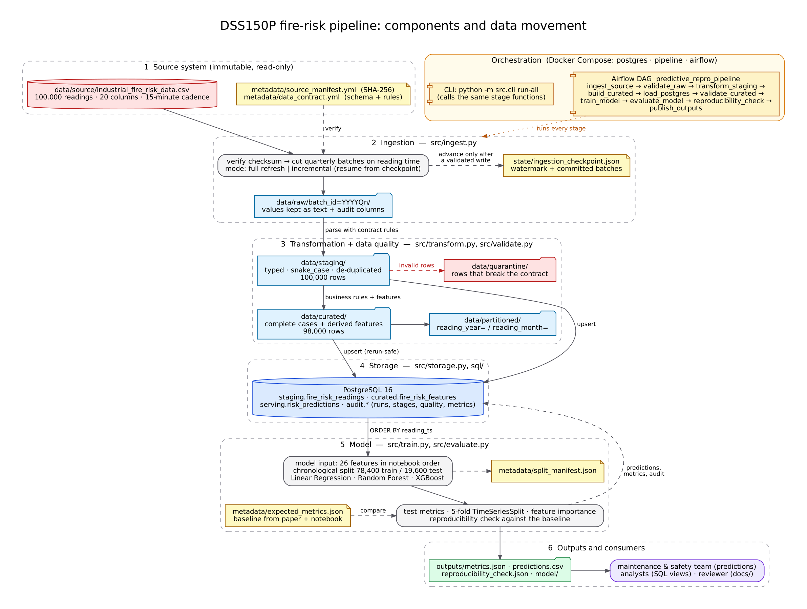
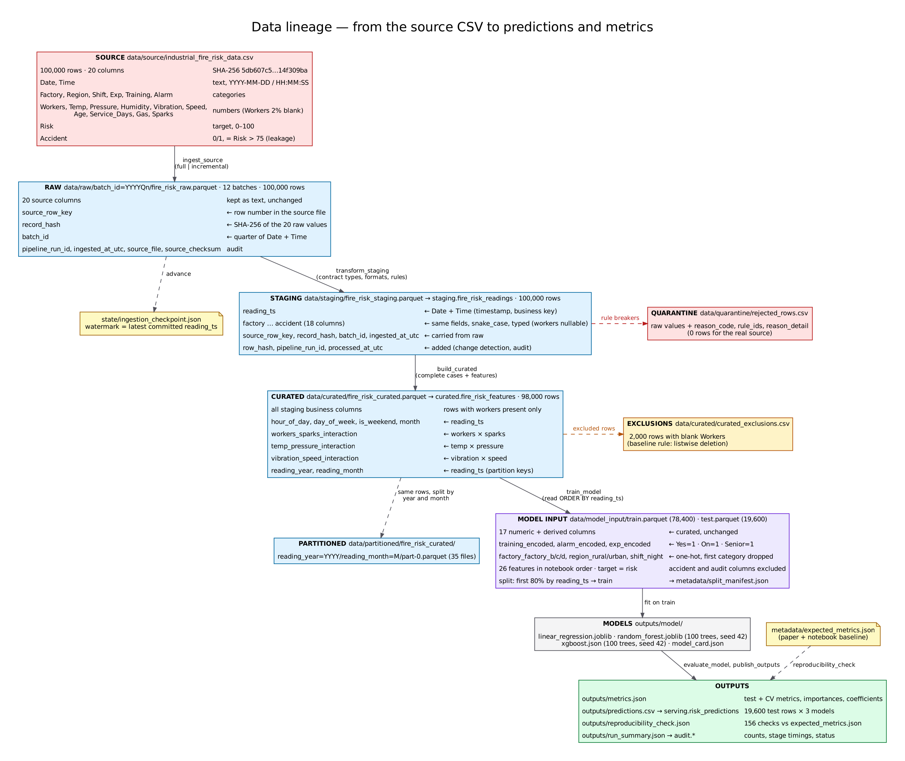

# DSS150P — Reproducible Fire-Risk Prediction Pipeline

Individual work for **DSS150P Fundamentals of Data Engineering, Integrated
Laboratory Activity #4 — Reproduction of a Predictive Analytics Project**.

Last term our Predictive Analytics group built a regression model for the
fire-risk score of industrial plants from IIoT sensor readings (*Integrating
IIoT Telemetry and Machine Health Indicators for Dynamic Fire Hazard
Assessment*). It lived in two Colab notebooks. This repository rebuilds that
project as a **reproducible data product**. It starts from the same source
file and reproduces the same model results, and anyone can rerun it from a
clean clone with one command. Better accuracy was not the goal; being able to
prove the result is the same was.

| Result | Value |
|---|---|
| Primary metric (Random Forest RMSE, chronological test set) | **3.235651** vs **3.24** reported in the paper (within the ±0.005 tolerance) |
| Automatic baseline checks | 156 checks: **130 pass, 0 fail**, 26 documented XGBoost-version deviations |
| Train/test rows | identical to the original notebook (same counts, boundaries and key hashes) |
| Reruns | byte-identical metrics and predictions; a second run adds **0 duplicate rows** |

**Contents:** [1 What it does](#1-what-the-pipeline-does) ·
[2 Architecture and lineage](#2-architecture-and-lineage) ·
[3 Prerequisites](#3-prerequisites) · [4 Setup](#4-setup-on-a-clean-machine) ·
[5 Run](#5-run-the-pipeline) · [6 Validate](#6-validate-the-results) ·
[7 Expected outputs](#7-expected-outputs) · [8 Storage benchmark](#8-storage-benchmark-and-partitions) ·
[9 Troubleshooting](#9-troubleshooting) · [10 Repository structure](#10-repository-structure) ·
[11 Configuration](#11-configuration) · [12 Documentation](#12-documentation-and-evidence) ·
[13 Credits](#13-student-information-credits-and-ai-use)

## 1. What the pipeline does

* **Source:** `industrial_fire_risk_data.csv` from Kaggle, 100,000 sensor
  readings taken every 15 minutes from 2021-01-01 to 2023-11-08, with 20
  columns. The file is treated as an immutable source system. Its SHA-256 is
  pinned in `metadata/source_manifest.yml` and checked before every run.
* **Predictive task:** regression of `Risk` (0–100) with the group's 26
  features and three models (Linear Regression, Random Forest, XGBoost). The
  first 80 % of the readings in time are used for training and the last 20 %
  for testing.
* **Engineering:** a data contract; full and checkpointed incremental
  ingestion; raw → staging → curated → model-input layers with audit columns
  and quarantine; a rerun-safe PostgreSQL load; a storage benchmark and
  partitions; an Apache Airflow DAG; data-quality checks and tests;
  structured logs and run records; automatic comparison of the new metrics
  with the old ones.

## 2. Architecture and lineage





| Layer | Where | Format | What it contains |
|---|---|---|---|
| Source | `data/source/industrial_fire_risk_data.csv` | CSV | the original file, never modified (not committed, see 4.2) |
| Raw | `data/raw/batch_id=<YYYYQn>/` | Parquet | faithful text copy in 12 quarterly arrival batches, plus `source_row_key`, `record_hash`, `batch_id`, `pipeline_run_id`, `ingested_at_utc`, `source_file`, `source_checksum` |
| Checkpoint | `state/ingestion_checkpoint.json` | JSON | committed batches and the watermark (latest committed `reading_ts`) |
| Staging | `data/staging/` and `staging.fire_risk_readings` | Parquet, PostgreSQL | typed and validated readings, one per `reading_ts`, with `row_hash`, `processed_at_utc` |
| Quarantine | `data/quarantine/rejected_rows.csv` | CSV | rows that break the contract, each with a reason code (none for the real file) |
| Curated | `data/curated/` and `curated.fire_risk_features` | Parquet, PostgreSQL | the business data product: 98,000 complete readings plus derived features (the 2,000 excluded rows are listed in `curated_exclusions.csv`) |
| Partitioned | `data/partitioned/fire_risk_curated/reading_year=*/reading_month=*/` | Parquet | the curated data split by month (35 files) |
| Model input | `data/model_input/train.parquet`, `test.parquet` | Parquet | the encoded 26-feature matrices; the split is documented in `metadata/split_manifest.json` |
| Outputs | `outputs/` and `serving.risk_predictions`, `audit.*` | JSON, CSV, PostgreSQL | metrics, predictions, feature importances, models, reproducibility check, run records |

The Airflow DAG `predictive_repro_pipeline` runs ten tasks in this order:
`ingest_source → validate_raw → transform_staging → build_curated →
load_postgres → validate_curated → train_model → evaluate_model →
reproducibility_check → publish_outputs`. The DAG file contains no business
logic. Every task calls one stage in `src/pipeline.py`, and the CLI calls the
same functions.

## 3. Prerequisites

| Needed | Notes |
|---|---|
| Git | to clone the repository |
| Docker Desktop (Windows/macOS) or Docker Engine + Compose v2 (Linux) | give Docker **at least 4 GB of memory**; the images need about 3 GB of disk |
| The source CSV | from Kaggle (4.2) |
| *Optional:* Python **3.12** | only for running without Docker (5.3) |
| *Optional:* Graphviz | only to re-render the diagrams (`python scripts/render_diagrams.py`) |

Everything was tested with Docker on Linux x86-64 and with a native
Python 3.12 virtual environment.

## 4. Setup on a clean machine

### 4.1 Clone

```bash
git clone <https://github.com/racabad27/DSS150P_REPRO_ABAD_ROLANDO.git> DSS150P_REPRO_ABAD_ROLANDO
cd DSS150P_REPRO_ABAD_ROLANDO
```

### 4.2 Get the source data

The licence of the Kaggle dataset could not be confirmed, so the CSV is not
in the repository (lab section 4.4). Download `industrial_fire_risk_data.csv`
from
[Kaggle — Industrial Fire and Accident Risk Predictor](https://www.kaggle.com/datasets/joganimitesh/industrial-fire-and-accident-risk-predictor)
and put it in `data/source/` **without opening it in Excel first**. Excel
rewrites the dates and changes the file. Then check it:

```bash
sha256sum data/source/industrial_fire_risk_data.csv                          # macOS/Linux/WSL
Get-FileHash data\source\industrial_fire_risk_data.csv -Algorithm SHA256      # Windows PowerShell
```

The result must be `5db607c512fad903bcfb6e242e2dcfc6ba8f9de091becf6169e6ae5414f309ba`.
Details: [`data/source/README.md`](data/source/README.md).

### 4.3 Create your `.env`

```bash
cp .env.example .env              # Windows PowerShell: Copy-Item .env.example .env
```

Open `.env` and set your own values. Only machine-specific values belong
there; everything about the pipeline is in `config/settings.yml`.

* `POSTGRES_PASSWORD`, `AIRFLOW_DB_PASSWORD`: any passwords you like.
* `POSTGRES_HOST_PORT`, `AIRFLOW_HOST_PORT`: change them if 5432 or 8080 is
  already used on your machine.
* `AIRFLOW_UID` (Linux/WSL only): the output of `id -u`, so the containers
  write files as you.

`.env` is git-ignored and must never be committed.

### 4.4 Build and start the services

```bash
docker compose build airflow pipeline   # first time: about 5–10 minutes
docker compose up -d                    # PostgreSQL + Airflow
docker compose ps                       # wait until both say "healthy"
```

`docker compose up` starts PostgreSQL first and waits for its health check.
It then creates Airflow's own metadata database (`airflow-db-init`) and
starts Airflow. The `pipeline` service is a one-off container that you start
with `docker compose run`.

## 5. Run the pipeline

### 5.1 With Airflow

Open http://localhost:8080. No login is needed in this local setup. Open
the DAG **predictive_repro_pipeline** and press **Trigger**. Or from a
terminal:

```bash
docker compose exec airflow airflow dags trigger predictive_repro_pipeline
docker compose exec airflow airflow dags list-runs predictive_repro_pipeline
```

A run takes about 4–5 minutes; most of it is cross-validation. Runtime
parameters (*Trigger → Run with config*):

| Parameter | Default | Meaning |
|---|---|---|
| `ingest_mode` | `incremental` | `full` rebuilds the raw layer and the checkpoint |
| `max_batches` | none | ingest at most N new quarterly batches (simulates data arriving) |
| `fail_after_batches` | none | failure drill: the first try stops after N batches and the retry resumes |

The DAG has no schedule (`schedule=None`, `catchup=False`). The source is a
frozen, checksum-pinned snapshot, so a run is started on demand when someone
wants to rebuild or verify the data product. Retries, timeouts, callbacks and
the shared run id are described in the DAG file and in
[`docs/runbook.md`](docs/runbook.md).

### 5.2 Without Airflow (one container)

```bash
docker compose run --rm pipeline                                  # = python -m src.cli run-all
docker compose run --rm pipeline python -m src.cli run-all --mode full
docker compose run --rm pipeline python -m src.cli status         # checkpoint + duplicate check
```

### 5.3 With a local virtual environment

```bash
python -m venv .venv                    # Windows: py -3.12 -m venv .venv
source .venv/bin/activate               # Windows: .venv\Scripts\activate
pip install -r requirements.txt
python -m src.cli env-check --check-db  # versions vs requirements.txt, config, database
python -m src.cli run-all               # needs PostgreSQL at POSTGRES_HOST:POSTGRES_PORT from .env
python -m src.cli run-all --skip-db     # the same pipeline without the database steps
```

To use the database from Docker with a local venv, keep
`POSTGRES_HOST=localhost` and set `POSTGRES_PORT` to the same value as
`POSTGRES_HOST_PORT`.

### 5.4 Command reference

| Command (`python -m src.cli ...`) | What it does |
|---|---|
| `env-check [--strict] [--check-db]` | Python and package versions against the pins, resolved configuration |
| `verify-source` | size and SHA-256 of the source against the manifest |
| `profile` | regenerate `metadata/source_profile.md/.json` |
| `ingest [--mode full] [--max-batches N] [--fail-after-batches N]` | raw ingestion with checkpoint |
| `status` | checkpoint, row counts and duplicate counts of the raw layer |
| `validate --layer raw\|curated [--skip-db]` | data-quality checks of a layer |
| `transform`, `build-curated`, `load-postgres` | the transformation and load stages |
| `train`, `evaluate`, `repro-check`, `publish` | the model stages |
| `run-all [--mode full] [--skip-db]` | every stage in order |
| `benchmark`, `partition-demo [--year Y --month M]` | storage experiment |
| `reset-raw --yes` | delete the raw layer and the checkpoint |
| `clean --yes` | delete every generated file (keeps the source, metadata and committed outputs) |

Exit codes: `0` ok, `2` configuration, `3` source, `4` data quality, `5`
database, `6` reproducibility, `75` failure drill. See the runbook.

## 6. Validate the results

```bash
docker compose run --rm pipeline pytest                        # unit, integration and data-quality tests
docker compose exec airflow python -m pytest tests/test_dag.py # DAG structure (inside the Airflow image)
docker compose run --rm pipeline python -m src.cli repro-check # metrics vs metadata/expected_metrics.json
docker compose exec postgres psql -U firerisk -d firerisk -c "SELECT * FROM audit.v_duplicate_check;"
docker compose exec postgres psql -U firerisk -d firerisk -c "SELECT * FROM audit.v_run_overview ORDER BY started_at_utc DESC;"
```

* The side-by-side comparison with the paper is in
  `outputs/reproducibility_summary.md` (machine-readable:
  `outputs/reproducibility_check.json`, and in SQL: `audit.v_metric_comparison`).
* Data-quality results of the last run: `outputs/quality/latest_*.json`.
* **Determinism check with Git:** after a run, `git status` should list only
  `outputs/run_summary.json`, `outputs/reproducibility_check.json` and
  `outputs/reproducibility_summary.md` (they contain the run id and time). The
  committed `metrics.json`, `predictions.csv` and `split_manifest.json` must
  come out byte for byte the same.

## 7. Expected outputs

| Output | Expected |
|---|---|
| Raw layer | 100,000 rows in 12 batches, 0 duplicate keys |
| Staging / quarantine | 100,000 rows / 0 rows |
| Curated | 98,000 rows (2,000 without `Workers` excluded, as in the original project) |
| Model input | 78,400 train rows (2021-01-01 00:00 → 2023-04-14 05:00), 19,600 test rows (2023-04-14 05:15 → 2023-11-08 15:45) |
| `outputs/metrics.json` | test RMSE: Linear Regression 3.4523, Random Forest 3.2357, XGBoost 3.2506 (+ MSE, MAE, R², 5-fold CV, importances, coefficients) |
| `outputs/predictions.csv` | 19,600 rows: actual risk and the prediction of each model |
| `outputs/feature_importance.csv` | importances of both tree models, ranked |
| `outputs/model/` | the three models (git-ignored) and `model_card.json` with their SHA-256 |
| `outputs/reproducibility_check.json` | status `PASS`: 130 passed, 0 failed, 26 accepted deviations |
| PostgreSQL | `staging.fire_risk_readings` (100,000), `curated.fire_risk_features` (98,000), `serving.risk_predictions` (58,800 = 3 models × 19,600), audit tables and views |

## 8. Storage benchmark and partitions

```bash
docker compose run --rm pipeline python -m src.cli benchmark
docker compose run --rm pipeline python -m src.cli partition-demo --year 2022 --month 6
```

The curated data is stored as CSV, JSON Lines, Parquet and a PostgreSQL table,
and the same 98,000 records are checked after every read. Parquet was the
smallest (5.2 MB vs 16.1 MB CSV and 52.9 MB JSONL) and the fastest to read.
PostgreSQL answered the selective query fastest through its index. Reading
the single June 2022 partition touched 1 of 35 files and returned 2,836 rows,
the same as the full file and PostgreSQL. Method, numbers and the format
choice for each job are in [`docs/benchmark_report.md`](docs/benchmark_report.md).

## 9. Troubleshooting

| Problem | Fix |
|---|---|
| `Source file not found` / checksum mismatch (exit 3) | put the original CSV in `data/source/` (4.2); never edit the manifest to make it pass |
| `Set POSTGRES_PASSWORD in .env` | create `.env` from `.env.example` (4.3) |
| `port is already allocated` | change `POSTGRES_HOST_PORT` / `AIRFLOW_HOST_PORT` in `.env` |
| `password authentication failed` after changing `.env` | the database volume keeps the first password: put it back, or `docker compose down -v` (deletes the database) |
| `PermissionError` on Linux/WSL | set `AIRFLOW_UID` to `id -u`, then `docker compose up -d --force-recreate` |
| Training killed (exit 137) | give Docker more memory (at least 4 GB) |
| Reproducibility check fails (exit 6) | `python -m src.cli env-check --strict`; see the runbook, section 3.4 |

The full list, with restart, checkpoint recovery, database reset and
rollback procedures, is in [`docs/runbook.md`](docs/runbook.md).

## 10. Repository structure

```text
DSS150P_REPRO_ABAD_ROLANDO/
├── README.md  .gitignore  .gitattributes  .dockerignore  .env.example
├── requirements.txt          exact package pins (Python 3.12)
├── Dockerfile                pipeline image
├── Dockerfile.airflow        Airflow image with the same pins
├── docker-compose.yml        postgres, airflow-db-init, airflow, pipeline
├── pytest.ini
├── config/settings.yml       every path, seed, model and pipeline parameter
├── data/                     source/ raw/ staging/ curated/ partitioned/ quarantine/ model_input/
├── metadata/                 source_manifest.yml, source_profile.md/.json, data_contract.yml,
│                             expected_metrics.json, split_manifest.json
├── src/                      config, contract, profiling, ingest, transform, validate, storage,
│                             benchmark, train, evaluate, observability, errors, pipeline, cli
├── sql/                      schema.sql, transformations.sql
├── dags/                     predictive_repro_pipeline.py
├── tests/                    unit, integration, data-quality and DAG tests
├── scripts/                  baseline capture, evidence and drill scripts, diagram rendering
├── docker/postgres/          creates Airflow's metadata database on first start
├── state/                    ingestion checkpoint (git-ignored)
├── logs/                     pipeline.jsonl and Airflow task logs (git-ignored)
├── outputs/                  metrics.json, predictions.csv, feature_importance.csv, model/,
│                             reproducibility check, run summary, benchmark results
└── docs/                     architecture.png, lineage.png, runbook.md, benchmark_report.md,
                              reproducibility_report.md, baseline_capture.md, diagrams/, evidence/
```

**Differences from the structure in the lab sheet** (allowed when the
separation of concerns is kept; explained here as required):

| Difference | Why |
|---|---|
| `data/model_input/` | the lab's *Model Input* layer gets its own folder, so the deterministic train/test matrices can be inspected |
| raw layer as `data/raw/batch_id=<YYYYQn>/` plus `data/raw/_runs/<run_id>.json` | one folder per arrival batch makes "skip committed batches" and duplicate checks simple; the run files record what each run ingested |
| extra modules in `src/` | `contract.py` (manifest and contract), `profiling.py`, `benchmark.py`, `observability.py` (logs and run records), `errors.py` (exit codes) and `pipeline.py` (the stage registry shared by the CLI and the DAG) keep each module focused |
| `Dockerfile.airflow`, `docker/postgres/` | Airflow needs its own image (same pins) and its own metadata database |
| `scripts/` | one-off tools that are not part of a pipeline run: baseline capture, evidence generators, failure drills, diagram rendering |
| `state/`, `logs/` | the checkpoint and the logs live outside the code, as the lab asks |
| `docs/diagrams/`, `docs/evidence/`, `docs/baseline_capture.md` | diagram sources as text, captured demonstration output, and the Phase I baseline and gap analysis |
| `outputs/model/` holds model files that are not committed | the Random Forest file is about 150 MB; `model_card.json` (committed) has their hashes |

## 11. Configuration

`config/settings.yml` holds everything that changes pipeline behaviour: paths
(all relative), the contract and manifest files, the batch frequency, the
quarantine threshold, the curated rule, the feature list and order,
encodings, the split, the seed, model hyperparameters, cross-validation, the
database settings and the benchmark settings. Values written as
`${NAME:-default}` can be overridden with environment variables without
touching any file:

| Variable | Default | Use |
|---|---|---|
| `PIPELINE_SOURCE_FILE` | `data/source/industrial_fire_risk_data.csv` | another location of the source |
| `PIPELINE_DATA_DIR`, `PIPELINE_OUTPUTS_DIR`, `PIPELINE_STATE_DIR`, `PIPELINE_LOGS_DIR` | `data`, `outputs`, `state`, `logs` | separate workspaces (used by the tests and drills) |
| `PIPELINE_BATCH_FREQUENCY` | `quarter` | `month` for smaller arrival batches (needs a full refresh) |
| `PIPELINE_MODEL_INPUT` | `postgres` | `parquet` trains from `data/curated/` instead of the database |
| `PIPELINE_VERIFY_CHECKSUM` | `true` | only failure drills turn it off |
| `PIPELINE_LOG_LEVEL` | `INFO` | console log detail |
| `POSTGRES_*` | from `.env` | database connection |

## 12. Documentation and evidence

| Document | Content |
|---|---|
| [`docs/reproducibility_report.md`](docs/reproducibility_report.md) | prior project vs reproduction, metric comparison, deviations, deterministic controls, limitations, answers to the 15 reflection questions, acceptance tests A1–A18 |
| [`docs/runbook.md`](docs/runbook.md) | normal operation, exit codes, common failures, restart/rerun, checkpoint recovery, database reset, rollback and cleanup |
| [`docs/benchmark_report.md`](docs/benchmark_report.md) | storage experiment and partitioning |
| [`docs/baseline_capture.md`](docs/baseline_capture.md) | the old project as a lifecycle, manual/hidden parts, baseline record, engineering-gap table |
| [`metadata/source_profile.md`](metadata/source_profile.md), [`metadata/data_contract.yml`](metadata/data_contract.yml) | source profile and data contract |
| [`docs/evidence/`](docs/evidence/) | captured output: incremental ingestion, failure drills, Airflow runs (with screenshots), test results, dependency sweep, comparison of the two source copies |

## 13. Student information, credits and AI use

| | |
|---|---|
| Student | Abad, Rolando Alfonso — student number *(2022136475)*, section *(CM17)* |
| Course | DSS150P Fundamentals of Data Engineering, Integrated Individual Laboratory Activity #4 |
| Previous group project | Risma, V. L. S.; Abad, R. A.; Toliba, M. G. — *Integrating IIoT Telemetry and Machine Health Indicators for Dynamic Fire Hazard Assessment* |
| Dataset | *Industrial Fire and Accident Risk Predictor* by Kaggle user "joganimitesh" |

The problem statement, features, model choices and baseline metrics come from
the group project, as the lab allows (section 4.1). The data engineering in
this repository is my individual work.

**AI use.** I used an AI assistant (Anthropic's Claude) to help design,
write, debug and test the code and to draft the documentation. I reviewed,
ran and checked all of it to ensure it functions as intended. Hence, the
reproducibility report.
