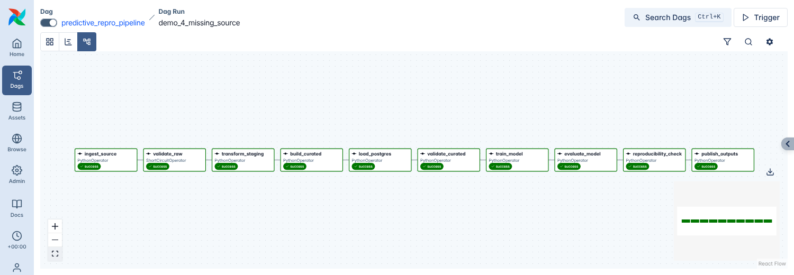
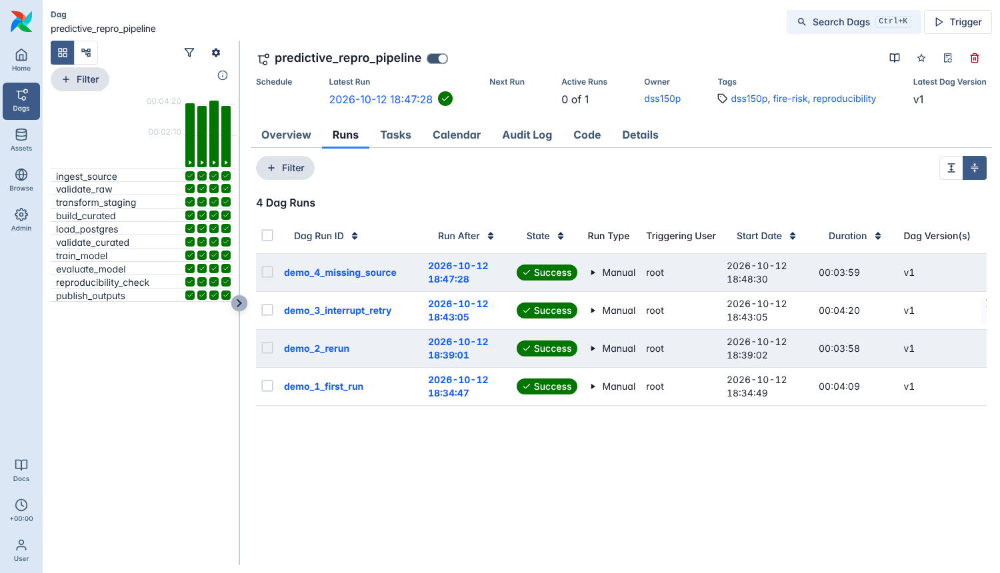
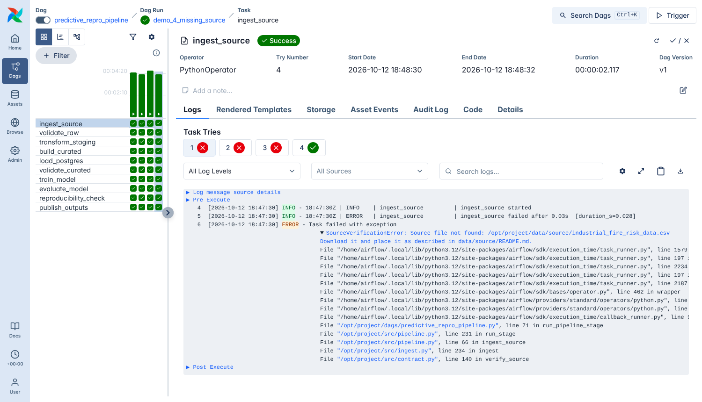

# Evidence: Airflow DAG runs

Generated by `docker compose exec airflow python scripts/airflow_evidence.py` on 2026-10-13 14:31 UTC (Airflow 3.3.2, LocalExecutor, Docker Compose). All times are UTC. Every DAG run uses one pipeline run id, `af_<DAG run id>`, for its files, log lines and audit rows.

Raw layer before the first run: 0 committed batches, 0 rows.

## Summary

| DAG run | conf | state | what it shows | checks |
|---|---|---|---|---|
| `demo_1_first_run` | defaults | success | First run | 2/2 ✔ |
| `demo_2_rerun` | defaults | success | Second run (rerun safety) | 4/4 ✔ |
| `demo_3_interrupt_retry` | `{"ingest_mode": "full", "fail_after_batches": 2}` | success | Interrupted ingestion, recovered by the automatic retry | 6/6 ✔ |
| `demo_4_missing_source` | defaults | failed → success | Failed run, fixed and recovered | 7/7 ✔ |

Dependency chain (from the DAG, checked by `tests/test_dag.py`):

`ingest_source → validate_raw → transform_staging → build_curated → load_postgres → validate_curated → train_model → evaluate_model → reproducibility_check → publish_outputs`

## 1. First run

Normal run with the default parameters (incremental ingestion of every batch that is not committed yet).

Triggered with `airflow dags trigger predictive_repro_pipeline --run-id demo_1_first_run`

DAG run `demo_1_first_run` · pipeline run id `af_demo_1_first_run` · final pipeline status **success**

| task | state | tries | duration (s) |
|---|---|---|---|
| ingest_source | success | 1 | 5.6 |
| validate_raw | success | 1 | 1.3 |
| transform_staging | success | 1 | 2.4 |
| build_curated | success | 1 | 2.8 |
| load_postgres | success | 1 | 8.6 |
| validate_curated | success | 1 | 1.5 |
| train_model | success | 1 | 14.2 |
| evaluate_model | success | 1 | 24.2 |
| reproducibility_check | success | 1 | 1.1 |
| publish_outputs | success | 1 | 2.5 |

- load_postgres result per table (inserted, updated, deleted): `staging.fire_risk_readings` (100000, 0, 0), `curated.fire_risk_features` (98000, 0, 0)
- ✔ DAG run finished with state success
- ✔ all 10 tasks succeeded

## 2. Second run (rerun safety)

The same DAG again with the same source. Nothing new may be ingested and the database load must change 0 rows.

Triggered with `airflow dags trigger predictive_repro_pipeline --run-id demo_2_rerun`

DAG run `demo_2_rerun` · pipeline run id `af_demo_2_rerun` · final pipeline status **success**

| task | state | tries | duration (s) |
|---|---|---|---|
| ingest_source | success | 1 | 1.8 |
| validate_raw | success | 1 | 1.3 |
| transform_staging | success | 1 | 2.4 |
| build_curated | success | 1 | 2.9 |
| load_postgres | success | 1 | 8.0 |
| validate_curated | success | 1 | 1.5 |
| train_model | success | 1 | 14.3 |
| evaluate_model | success | 1 | 24.7 |
| reproducibility_check | success | 1 | 1.0 |
| publish_outputs | success | 1 | 2.8 |

- load_postgres result per table (inserted, updated, deleted): `staging.fire_risk_readings` (0, 0, 0), `curated.fire_risk_features` (0, 0, 0)
- ✔ DAG run finished with state success
- ✔ all 10 tasks succeeded
- ✔ no new batch was ingested (0 written)
- ✔ database load inserted/updated/deleted 0 rows in every table

## 3. Interrupted ingestion, recovered by the automatic retry

Full refresh with a failure drill: the first try of ingest_source stops on purpose after two committed batches. Airflow retries the task (retries=2, 20 s delay) and the retry continues from the checkpoint.

Triggered with `airflow dags trigger predictive_repro_pipeline --run-id demo_3_interrupt_retry --conf '{"ingest_mode": "full", "fail_after_batches": 2}'`

DAG run `demo_3_interrupt_retry` · pipeline run id `af_demo_3_interrupt_retry` · final pipeline status **success**

| task | state | tries | duration (s) |
|---|---|---|---|
| ingest_source | success | 2 | 2.6 |
| validate_raw | success | 1 | 1.2 |
| transform_staging | success | 1 | 2.4 |
| build_curated | success | 1 | 2.9 |
| load_postgres | success | 1 | 7.9 |
| validate_curated | success | 1 | 1.5 |
| train_model | success | 1 | 14.1 |
| evaluate_model | success | 1 | 23.9 |
| reproducibility_check | success | 1 | 1.1 |
| publish_outputs | success | 1 | 2.8 |

Structured log of `ingest_source` (`logs/pipeline.jsonl`, all tries):

```text
14:34:18.001Z INFO    ingest_source started
14:34:18.082Z INFO    Source matches the manifest (size and SHA-256)
14:34:18.173Z INFO    Full refresh: raw layer and checkpoint reset
14:34:18.682Z INFO    12 batches in source, 0 already committed, 12 to ingest now
14:34:18.778Z INFO    Batch 2021Q1 committed (8,640 rows)
14:34:18.870Z INFO    Batch 2021Q2 committed (8,736 rows)
14:34:18.880Z ERROR   ingest_source failed after 0.87s   <- SimulatedInterruption
14:34:40.136Z INFO    ingest_source started
14:34:40.219Z INFO    Source matches the manifest (size and SHA-256)
14:34:40.731Z INFO    12 batches in source, 2 already committed, 10 to ingest now
14:34:40.851Z INFO    Batch 2021Q3 committed (8,832 rows)
14:34:40.943Z INFO    Batch 2021Q4 committed (8,832 rows)
14:34:41.036Z INFO    Batch 2022Q1 committed (8,640 rows)
14:34:41.126Z INFO    Batch 2022Q2 committed (8,736 rows)
14:34:41.216Z INFO    Batch 2022Q3 committed (8,832 rows)
14:34:41.312Z INFO    Batch 2022Q4 committed (8,832 rows)
14:34:41.412Z INFO    Batch 2023Q1 committed (8,640 rows)
14:34:41.506Z INFO    Batch 2023Q2 committed (8,736 rows)
14:34:41.602Z INFO    Batch 2023Q3 committed (8,832 rows)
14:34:41.681Z INFO    Batch 2023Q4 committed (3,712 rows)
14:34:41.697Z INFO    ingest_source finished (success) in 1.55s
```

`audit.pipeline_errors` rows of this run:

| stage | try | error type | message (first 80 characters) |
|---|---|---|---|
| ingest_source | 1 | SimulatedInterruption | Failure drill: run stopped on purpose after 2 committed batch(es). Rerun the sam |

- load_postgres result per table (inserted, updated, deleted): `staging.fire_risk_readings` (0, 0, 0), `curated.fire_risk_features` (0, 0, 0)
- Run record: ingest_source attempts = 2, batches written by the retry = 10 of 12.
- ✔ DAG run finished with state success
- ✔ all 10 tasks succeeded
- ✔ ingest_source needed 2 tries
- ✔ the first try was recorded in audit.pipeline_errors (SimulatedInterruption)
- ✔ the retry wrote only the remaining batches (total - 2)
- ✔ after the full refresh the load changed 0 rows (staging and curated rebuilt identically)

## 4. Failed run, fixed and recovered

The source CSV is moved away before the run. ingest_source fails on all three tries, so nothing downstream runs and nothing is published. Then the file is put back and only the failed tasks of the SAME DAG run are cleared, so the run continues to the end.

Triggered with `airflow dags trigger predictive_repro_pipeline --run-id demo_4_missing_source`

DAG run `demo_4_missing_source` · pipeline run id `af_demo_4_missing_source` · final pipeline status **success**

Task states **before** the fix:

| task | state | tries |
|---|---|---|
| ingest_source | failed | 3 |
| validate_raw | upstream_failed | 0 |
| transform_staging | upstream_failed | 0 |
| build_curated | upstream_failed | 0 |
| load_postgres | upstream_failed | 0 |
| validate_curated | upstream_failed | 0 |
| train_model | upstream_failed | 0 |
| evaluate_model | upstream_failed | 0 |
| reproducibility_check | upstream_failed | 0 |
| publish_outputs | upstream_failed | 0 |

Task states **after** putting the file back and clearing the failed tasks:

| task | state | tries | duration (s) |
|---|---|---|---|
| ingest_source | success | 4 | 1.8 |
| validate_raw | success | 1 | 1.2 |
| transform_staging | success | 1 | 2.4 |
| build_curated | success | 1 | 2.9 |
| load_postgres | success | 1 | 7.8 |
| validate_curated | success | 1 | 1.5 |
| train_model | success | 1 | 14.1 |
| evaluate_model | success | 1 | 24.5 |
| reproducibility_check | success | 1 | 1.1 |
| publish_outputs | success | 1 | 2.7 |

Structured log of `ingest_source` (`logs/pipeline.jsonl`, all tries):

```text
14:35:50.406Z INFO    ingest_source started
14:35:50.449Z ERROR   ingest_source failed after 0.03s   <- SourceVerificationError
14:36:12.496Z INFO    ingest_source started
14:36:12.539Z ERROR   ingest_source failed after 0.03s   <- SourceVerificationError
14:36:34.620Z INFO    ingest_source started
14:36:34.663Z ERROR   ingest_source failed after 0.03s   <- SourceVerificationError
14:37:00.599Z INFO    ingest_source started
14:37:00.681Z INFO    Source matches the manifest (size and SHA-256)
14:37:01.183Z INFO    12 batches in source, 12 already committed, 0 to ingest now
14:37:01.305Z INFO    No pending batches - raw layer already up to date
14:37:01.316Z INFO    ingest_source finished (success) in 0.71s
```

`audit.pipeline_errors` rows of this run:

| stage | try | error type | message (first 80 characters) |
|---|---|---|---|
| ingest_source | 1 | SourceVerificationError | Source file not found: /opt/project/data/source/industrial_fire_risk_data.csv Do |
| ingest_source | 2 | SourceVerificationError | Source file not found: /opt/project/data/source/industrial_fire_risk_data.csv Do |
| ingest_source | 3 | SourceVerificationError | Source file not found: /opt/project/data/source/industrial_fire_risk_data.csv Do |

- Cleared 10 task instance(s) of the same DAG run: ingest_source, publish_outputs, load_postgres, evaluate_model, validate_raw, validate_curated, transform_staging, reproducibility_check, train_model, build_curated.
- load_postgres result per table (inserted, updated, deleted): `staging.fire_risk_readings` (0, 0, 0), `curated.fire_risk_features` (0, 0, 0)
- Run record: ingest_source attempts = 4 (3 failed tries + 1 after the fix), same pipeline_run_id throughout.
- ✔ the run failed before the fix
- ✔ ingest_source failed on all 3 tries
- ✔ no downstream task ran (all upstream_failed)
- ✔ published outputs unchanged while the run was broken
- ✔ 3 errors recorded in audit.pipeline_errors (SourceVerificationError)
- ✔ after the fix the SAME DAG run succeeded
- ✔ pipeline run record ends with status success

## PostgreSQL after the four runs

`SELECT ... FROM audit.v_run_overview`:

| pipeline_run_id | status | trigger | duration_s | raw_rows | staging_rows | curated_rows | train_rows | test_rows | prediction_rows | failed_checks |
|---|---|---|---|---|---|---|---|---|---|---|
| af_demo_1_first_run | success | airflow | 65.7 | 100000 | 100000 | 98000 | 78400 | 19600 | 19600 | 0 |
| af_demo_2_rerun | success | airflow | 64.8 | 100000 | 100000 | 98000 | 78400 | 19600 | 19600 | 0 |
| af_demo_3_interrupt_retry | success | airflow | 87.2 | 100000 | 100000 | 98000 | 78400 | 19600 | 19600 | 0 |
| af_demo_4_missing_source | success | airflow | 134.0 | 100000 | 100000 | 98000 | 78400 | 19600 | 19600 | 0 |

`SELECT * FROM audit.v_duplicate_check`:

| table_name | row_count | duplicate_business_keys |
|---|---|---|
| curated.fire_risk_features | 98000 | 0 |
| staging.fire_risk_readings | 100000 | 0 |

## Overall

- ✔ raw layer: 0 duplicate source_row_keys after all runs
- ✔ PostgreSQL: 0 duplicate business keys (reading_ts) in staging and curated
- ✔ metrics.json, predictions.csv, feature_importance.csv and split_manifest.json byte-identical before and after the four runs

SHA-256 of the watched outputs after the runs:

| file | sha256 (first 16) | unchanged |
|---|---|---|
| `outputs/metrics.json` | bc6cb30a09197cfc | yes |
| `outputs/predictions.csv` | 882a9c9db3f5b925 | yes |
| `outputs/feature_importance.csv` | 8174275f861ebf9b | yes |
| `metadata/split_manifest.json` | 4816f3650f26e579 | yes |

## Screenshots

Taken in the Airflow UI (http://localhost:8080) after the script finished.

Graph view - the ten tasks and their dependencies:



Grid view - the four demo runs, one column per run:



`ingest_source` in `demo_4_missing_source` - tries 1-3 failed (source missing), try 4 succeeded after the fix:


